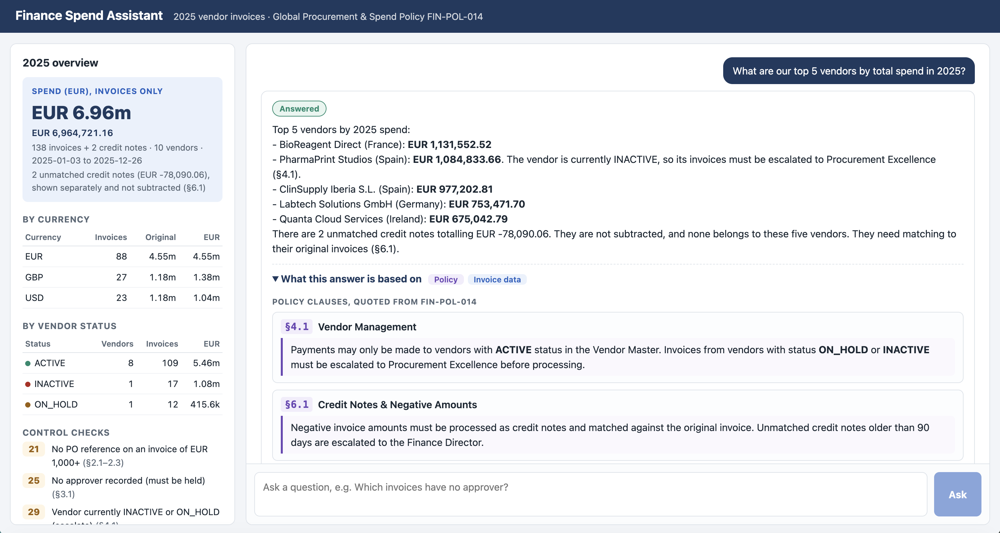
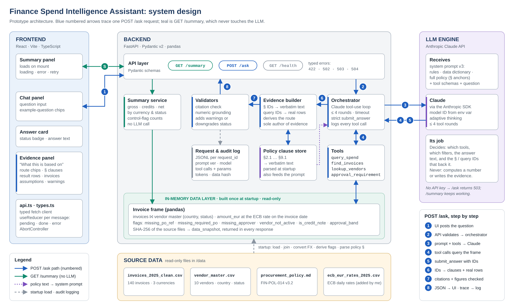

# Finance Spend Intelligence Assistant



A small web app where a finance analyst asks questions about the 2025 vendor invoices and the procurement policy. Every answer shows what it is based on: the policy clauses, quoted word for word, and the invoice rows behind each figure.

**Stack:** FastAPI · Pydantic · pandas · React · Vite · TypeScript · Claude (Anthropic API)

> **LLM path:** the app calls Claude through the Anthropic API. The key is read from a setting named `key_1`. Without a key, the summary still works and questions return a clear "AI not set up" message (HTTP 503).

---

## Contents

1. [Quick start](#quick-start)
2. [A two-minute tour (no coding knowledge needed)](#a-two-minute-tour-no-coding-knowledge-needed)
3. [Configuration](#configuration)
4. [Architecture](#architecture)
5. [API](#api)
6. [Key design decisions](#key-design-decisions)
7. [Grounding and guardrails](#grounding-and-guardrails)
8. [Data notes and assumptions](#data-notes-and-assumptions)
9. [Write-up](#write-up): what I built and left out · how I'd evaluate it · what production would need
10. [Testing](#testing)
11. [Repository layout](#repository-layout)
12. [How I worked with AI](#how-i-worked-with-ai)
13. [Time taken and next steps](#time-taken-and-next-steps)

---

## Quick start

**You need:** Python 3.11+, Node.js 20+, and a Claude API key.

### 1. Backend (http://localhost:8000)

```bash
cd backend
python3 -m venv .venv
source .venv/bin/activate            # Windows: .venv\Scripts\activate
pip install -r requirements.txt
cp .env.example .env                 # then open .env and set: key_1=<your Claude API key>
python -m uvicorn app.main:app --reload --port 8000
```

Check that it's running: <http://localhost:8000/health>. The interactive API docs are at <http://localhost:8000/docs>.

### 2. Frontend (http://localhost:5173)

In a second terminal:

```bash
cd frontend
npm install
npm run dev
```

Open <http://localhost:5173>. The summary appears straight away. Click an example question to try the assistant.

### 3. Tests

```bash
cd backend && pytest
```

`make install`, `make backend`, `make frontend` and `make test` run the same commands (see the [Makefile](Makefile)).

---

## A two-minute tour (no coding knowledge needed)

**What happens when an analyst asks "What are our top 5 vendors by spend?"**

1. **The page sends the question to the backend.** The backend is a small web server written in Python.
2. **The backend asks Claude what to look up.** Claude receives the question, the full policy text, a description of the data, and a list of four "calculators" (called tools) it may use. Claude decides it needs `query_spend` grouped by vendor, top 5.
3. **The backend does the maths, not Claude.** The tool ranks vendors using the invoice table, in which every amount has already been converted to EUR. The result is labelled `q1`.
4. **Claude writes the answer and cites its sources by ID.** For example: "based on `q1` and policy clause `5.1`". It never copies data or quotes itself.
5. **The backend builds the evidence.** It looks up the real text of clause 5.1 in the policy file and the real invoices behind `q1`. Because of this, the evidence on screen cannot be invented.
6. **The backend checks the answer.** Every clause cited must exist. Every number in the answer must match a calculation result or the policy. Anything that doesn't check out is shown as a warning.
7. **The page shows the answer** with a status badge and a panel titled "What this answer is based on".

When the data can't answer a question, the assistant says so. For example, "Were any invoices self-approved?" can't be answered because the data has no requester field. The assistant names what is missing instead of guessing.

**Where to look in the code.** Each file starts with a plain-English explanation.

| If you want to understand… | Read |
|---|---|
| How the data is prepared (EUR conversion, control flags) | `backend/app/data/loader.py` |
| What Claude is told | `backend/app/llm/prompts/system_v3.md` |
| The conversation loop with Claude | `backend/app/llm/orchestrator.py` |
| How evidence is built and checked | `backend/app/evidence.py`, `backend/app/validators.py` |
| The four calculators | `backend/app/tools/` |
| The screen | `frontend/src/components/` |

---

## Configuration

Settings live in `backend/.env`; copy it from `backend/.env.example`. Real environment variables override the file.

| Setting | Required | Default | What it does |
|---|---|---|---|
| `key_1` | For questions | none | Your Claude API key. Never logged and never returned by the API. |
| `ANTHROPIC_MODEL` | No | `claude-sonnet-5-5` | Which Claude model answers questions ([current models](https://platform.claude.com/docs/en/models/overview)) |
| `LLM_EFFORT` | No | `medium` | How much the model thinks before answering (`low`, `medium`, `high`), or `none` to use the model's default |
| `LLM_TEMPERATURE` | No | not sent | Only for models that accept sampling parameters. Current models such as `claude-sonnet-5-5` reject them. |
| `LLM_TIMEOUT_SECONDS` | No | `60` | Timeout for each Claude call |
| `ASK_DEADLINE_SECONDS` | No | `120` | Time limit for a whole question, across all its Claude calls |
| `LLM_MAX_TOKENS` | No | `8000` | Maximum length of each Claude reply, thinking included |
| `MAX_TOOL_ROUNDS` | No | `4` | How many rounds of data lookups Claude may make per question |
| `DATA_DIR` | No | `../data` | Folder with the source files |
| `LOG_DIR` | No | `logs` | Where the audit log (`audit.jsonl`) is written |
| `CORS_ORIGINS` | No | `http://localhost:5173` | Which web pages may call the API |

The frontend reads `VITE_API_URL` (default `http://localhost:8000`); see `frontend/.env.example`.

---

## Architecture



**The rule: Claude decides, Python computes, and the server writes the evidence.**

How one `POST /ask` request flows (the numbers match the diagram):

1. The UI posts the question.
2. The API validates it and hands it to the orchestrator.
3. The orchestrator sends Claude the system prompt (rules, data dictionary, the full policy with § anchors), the tool definitions and the question.
4. Claude calls tools. Each call is validated, run against the in-memory invoice table, and logged with a query ID. This repeats for at most 4 rounds.
5. Claude finishes by calling `submit_answer`. It returns a status, the answer text, and the clause IDs and query IDs it relied on.
6. The evidence builder turns those IDs into verbatim clause text and real invoice rows, and works out the route.
7. The validators check every citation and every figure.
8. The response goes back to the UI, and the full trace goes to the audit log.

`GET /summary` takes a separate path that never calls Claude.

| Component | Responsibility |
|---|---|
| `app/data/loader.py` | Loads the CSVs once at startup, joins the vendor master, converts to EUR, adds control flags and approval bands, fingerprints the files |
| `app/data/fx.py` | Picks the exchange rate for each invoice date (§5.1) |
| `app/policy/parser.py` | Splits the policy into citable clauses (§1 … §9.1) |
| `app/policy/approval.py` | The §3 approval bands, with exact edges |
| `app/tools/` | `query_spend`, `find_invoices`, `lookup_vendors`, `approval_requirement`, with validated parameters |
| `app/llm/orchestrator.py` | The loop with Claude: bounded rounds, a strict final-answer tool, up to two corrective retries, an overall deadline |
| `app/llm/prompts/system_v3.md` | The versioned system prompt (`ask-v3`; earlier versions are kept for comparison) |
| `app/evidence.py` | The only place where evidence is created |
| `app/validators.py` | Numeric grounding check |
| `app/assistant.py` | Ties it together: health, summary, ask, audit log |
| `app/main.py` | Web layer: routes, request IDs, typed errors, CORS |

---

## API

The interactive docs are at <http://localhost:8000/docs> while the backend is running.

### `POST /ask`

Request: `{ "question": "Who is allowed to approve an invoice of EUR 60,000?" }`

Response (shortened):

```jsonc
{
  "request_id": "3f9c0a1b2d4e",
  "status": "answered",           // answered | partial | insufficient_data | out_of_scope
  "answer": "An invoice of EUR 60,000 falls in the 50,000.01 – 250,000 band, so the **Finance Director** must approve it (§3). Self-approval is prohibited at every threshold (§7.2).",
  "route": ["policy"],            // worked out from what was actually used, not reported by the model
  "evidence": {
    "policy": [
      { "clause_id": "3",   "section_title": "Approval Thresholds",   "text": "| Invoice / PO Value (EUR) | Required Approver | …" },
      { "clause_id": "7.2", "section_title": "Segregation of Duties", "text": "Self-approval is prohibited at all thresholds." }
    ],
    "data": []                    // one entry per data query: description, params, rows, totals, contributing invoices
  },
  "assumptions": [],
  "missing_information": [],
  "warnings": [],
  "meta": { /* model, prompt_version, latency_ms, llm_calls, tool_calls, tokens, data_snapshot */ }
}
```

| Field | Meaning |
|---|---|
| `status` | Drives the badge in the UI: Answered, Partial answer, Can't answer from the data, or Out of scope |
| `route` | `policy`, `data` or both |
| `evidence.policy[]` | Verbatim clauses, looked up by the server from the clause IDs |
| `evidence.data[]` | Per query: a plain-English description of the computation, the parameters, the result rows and totals, and the contributing invoices (at most 50, with the full count) |
| `assumptions[]` | Standard ones added by the server (FX basis, unmatched credit notes shown separately and not subtracted, all vendor statuses), plus any the model states |
| `missing_information[]` | What data would be needed (for `partial` and `insufficient_data`) |
| `warnings[]` | Removed citations and unverified figures. Either one turns an `answered` status into `partial` |
| `meta` | Model, prompt version, latency, Claude calls, tool calls, token counts and data fingerprint |

### `GET /summary`

Spend in EUR (invoices only, the headline), with the unmatched credit notes reported separately and a net figure for reference; breakdowns by currency and by vendor status (invoices only); counts of control exceptions (no PO reference on an invoice of EUR 1,000+, no approver, non-active vendor, unmatched credit notes); the FX basis; and a SHA-256 fingerprint of each source file.

### `GET /health`

`{"status": "ok", "llm_configured": true, "model": "claude-sonnet-5-5", "data_snapshot": "sha256:…"}`

### Errors

Every error has the same shape: `{ "error": { "code", "message", "request_id" } }`

| HTTP | `code` | When |
|---|---|---|
| 422 | `invalid_question` | The question is empty or over 1,000 characters |
| 502 | `llm_bad_output` | Claude's answer was still unusable after the corrective retries, or was cut off by the token limit |
| 503 | `llm_not_configured` | No `key_1` is set |
| 503 | `llm_unavailable` | Claude can't be reached, rejected the key or model, or is rate-limiting |
| 504 | `llm_timeout` | A Claude call, or the whole question, took longer than the time limit |
| 500 | `internal_error` | Anything unexpected |

---

## Key design decisions

| Decision | Why | Alternative rejected |
|---|---|---|
| Claude never does arithmetic; tools compute every figure | Sums across three currencies are exactly where models slip, and tool calls leave a trail | Putting all 140 rows in the prompt |
| The whole policy goes in the prompt, split into clause IDs | It's about 50 lines, so retrieval would only add a way to fail | A vector database |
| The server builds evidence from IDs | The model can't fabricate a quote or a row | Asking the model to quote its sources |
| Four parameterised tools | Inputs are validated and tested, and every call is logged | Text-to-SQL (a next step, behind an allow-list) |
| Native Anthropic SDK tool use, no agent framework | Few moving parts; the loop is short and readable | LangChain and similar |
| A strict `submit_answer` tool | The API guarantees the final reply matches the schema; the status drives the UI | Parsing free text |
| Request shape suited to current models: `tool_choice` "auto", no temperature, thinking blocks passed back, `effort` setting | `claude-sonnet-5-5` rejects forced tool choice and sampling parameters, and thinks by default | Forcing the tool call (rejected with HTTP 400) |
| FX at the official ECB rate for the invoice date, from the ECB's own file, read unchanged | Follows policy §5.1 exactly; the file's fingerprint is on every answer | Approximate or average rates |
| Spend means invoices only, in EUR, across all vendor statuses. Unmatched credit notes are shown next to it, never subtracted | Policy §6.1 requires a credit note to be matched to its original invoice, and the data can't do that. Stated on every answer | Netting them silently (the first generated version did this) |
| A missing PO is a breach only from EUR 1,000, measured after conversion | Policy §2.1 sets the threshold; flagging every missing PO would overstate breaches | Treating every blank PO field as a breach (the first generated version did this) |
| `route` is worked out from the evidence | Accurate by construction | Asking the model to classify the question |
| Stateless, single-turn `/ask` | Easy to test; chat history wasn't the chosen stretch goal | Multi-turn memory |
| The prompt caches its static prefix (`cache_control`) | Cheaper and faster repeat questions | No caching |

---

## Grounding and guardrails

Five layers keep answers grounded:

1. **Structural.** Evidence comes from the server, never from the model.
2. **Citation check.** Clause IDs must exist and query IDs must have run in this request. Anything else is removed and flagged, and the status drops to `partial`.
3. **Numeric grounding.** Every figure in the answer must match a tool result, the policy or the question, allowing for rounding. Otherwise the UI shows an "unverified figure" warning and an `answered` status drops to `partial`, so an unchecked number is never shown as a complete answer.
4. **No tool, no number.** An answer that states figures without having looked at any data is sent back once for correction.
5. **Failure handling.** Tool errors go back to Claude so it can fix its request. Lookups beyond the limit are refused, a plain-text reply is sent back for a proper answer, each question has an overall deadline, and every Claude problem becomes a typed error.

**Guardrails (the one stretch goal).** Every answer has a status. The prompt carries a catalogue of what the data doesn't contain and which clauses each gap blocks:

| Missing from the data | Policy it blocks | Example question → behaviour |
|---|---|---|
| Requester | §7.1, §7.2 segregation of duties | *Were any invoices self-approved?* → `insufficient_data` |
| Approver role and limit | §3 authority | *Did m.garcia have authority to approve INV-20003?* → names the required level and says authority can't be confirmed |
| Link from a credit note to its original invoice | §6.1 matching | *Which credit notes are unmatched?* → `partial` |
| PO issue date and PO value | §2.1 "before the work", §2.3 blanket PO; §3 bands by "Invoice / PO Value" | → `insufficient_data` or `partial`; approval answers state that bands use the invoice amount |
| A reporting ("as of") date | §6.1 escalate unmatched credit notes older than 90 days | *Which credit notes are over 90 days old?* → asks for a date; with one, ages come from `find_invoices` (`as_of`) |
| Vendor status history | §4.1 only pay ACTIVE vendors | Status is labelled "currently"; answers state that it may not be the status when the invoice was processed |
| Receipt and payment dates | §5.2 payment terms | → `insufficient_data` |
| Exception Register | §9.1 emergency exceptions | → `insufficient_data` |
| Due diligence, bank-detail changes | §4.2, §4.3 | → `insufficient_data` |
| Budgets, contracts, data before 2025 | none | → `insufficient_data` |
| Clinical-trial site payments | §1 (covered by FIN-POL-021 instead) | → `out_of_scope` |

When a result reveals a control issue, the answer names the action the policy requires. Examples: no approver (§3.1, hold the invoice) and an inactive or on-hold vendor (§4.1, escalate). Invoice text is treated as data, never as instructions.

---

## Data notes and assumptions

| Finding in the data | How the app handles it |
|---|---|
| Three currencies: 89 invoices in EUR, 27 in GBP, 24 in USD | Converted once at load, at the rate for the invoice date (§5.1). Both the original and the EUR amount are kept. |
| Conversion can change the approval band: INV-20065 (GBP 47,368.81) and INV-20071 (USD 51,057.79) | Bands are computed after conversion, by code, and tested |
| Two credit notes (INV-20029, INV-20096, both Helix Consulting AG, EUR -78,090.06), not linked to any original | Not subtracted from spend (§6.1 requires matching first). Shown separately in totals, next to their vendor in breakdowns, and in an assumption on every spend answer. A net figure is given only when the user asks for one |
| 21 invoices have no PO reference, 10 of them for cloud hosting or facilities (§2.3 blanket POs) | Flagged as a §2.1 exception only when the invoice is EUR 1,000 or more after conversion (`missing_required_po`). All 21 happen to be above the threshold, and a test proves that a smaller invoice would not be flagged. Reported as "no PO reference on the invoice", with the blanket-PO caveat |
| 25 invoices have no approver | Flagged under §3.1: must be held |
| 29 invoices come from PharmaPrint Studios (INACTIVE) or Crown Travel Partners (ON_HOLD) | Included in spend and called out under §4.1: escalate. The vendor master gives today's status only, so these are vendors *currently* not active; the data can't show their status when each invoice was processed |

**Exchange rates.** The data pack has no exchange rates, so I downloaded the official ECB euro reference rates for every business day of 2025 and added them as `data/ecb_eur_rates_2025.csv`, unchanged. Each invoice uses the rate for its own date; the 16 GBP and USD invoices dated on a weekend or ECB holiday use the previous business day's rate. Every answer states this, and the file's SHA-256 fingerprint is in `/summary` and the audit log. See [data/SOURCES.md](data/SOURCES.md).

---

## Write-up

### What I built and what I left out

**Built:**

- a deterministic data core with EUR conversion, control flags, approval bands and file fingerprints
- `GET /summary`
- a tool-calling `POST /ask` whose evidence is assembled by the server
- an evidence-first React UI with explicit loading, error and retry states
- guardrails (the one stretch goal), so the assistant declines, answers partially, or escalates when the data can't support a full answer

**Left out, and why:**

- auth, deployment and CI: out of scope per the brief
- a vector database: the policy is about 50 lines
- text-to-SQL: I chose auditability over flexibility in the time box
- chat history and multi-turn conversation, Docker, and visual polish

The priority throughout was an answer an analyst can verify, over breadth.

### How I'd evaluate it

- **Tool layer (done):** unit tests check every tool against an independent pandas reference (`tests/reference.py`) that never imports app code.
- **Answer flow (done):** a scripted fake Claude exercises every path: happy path, policy-only, decline, corrections, removed citations, unverified figures (and the status downgrade they cause), the lookup limit, thinking blocks, deadlines, errors.
- **Answer quality with the real model (designed, see `docs/plan.md` §12):** ten cases in four groups (data, policy, both, should-decline). Expected values come from the reference script. Scoring is deterministic: status, figures (±0.5%), required clauses, route and evidence rows. Each case runs three times, and a flaky case counts as failing. Answering a should-decline case is critical. Over-declining is an ordinary failure.
- **Hallucinations in use:** the citation and numeric validators run on every answer. Their warning rate per prompt version is a live metric, read from the audit log.
- **Over time:** grow to 30–50 cases labelled by finance experts. Add an LLM judge only after calibrating it against human labels. Gate every prompt or model change on the suite.

### What production would need

- **Data:** a read-only connection to the AP system or warehouse, with versioned snapshots; FX from Treasury; the policy from document control, with its version on every answer.
- **Audit trail (§8.2):** the JSONL log becomes an append-only store, with the user identity added. Retention is agreed with Compliance; §8.1 keeps procurement records for 10 years.
- **Access control:** SSO, and row-level permissions by entity or cost centre, enforced inside the tools and never in the prompt.
- **Cost for about 200 users:** prompt caching (already on), a cached summary, a smaller model for simple questions, per-user rate limits, and token usage per request (already in `meta` and the log).
- **Governance:** a fallback model, a data-residency and vendor review, and the rule that the assistant informs but never approves or pays.

---

## Testing

```bash
cd backend && pytest
```

| File | What it proves |
|---|---|
| `test_fx.py` | The right rate for each date (weekends fall back to the previous business day); every EUR amount matches its recorded rate |
| `test_approval.py` | Exact band edges (5,000.00 vs 5,000.01, and so on); bands match the policy text; FX moves INV-20065 and INV-20071 across a band; the EUR 1,000 PO threshold matches §2.1 |
| `test_loader.py` | Row and currency counts; control-flag counts (21 / 25 / 29 / 2); a missing PO under EUR 1,000 is not a breach; credit notes never need a PO; lineage fingerprints |
| `test_policy_parser.py` | All clauses found, verbatim; loose references such as "§ 3.1" understood |
| `test_tools.py` | All four tools match the independent reference; credit notes are not subtracted by default, appear next to their vendor, and are netted only on request; invoice ages are counted only to a date the user gives; bad parameters become clear errors, not crashes |
| `test_validators.py` | Figures are parsed, identifiers are ignored, rounding is allowed, invented numbers are caught |
| `test_ask_flow.py` | The whole question flow with a scripted fake Claude, including every safety net (an invented figure turns Answered into Partial), the data gaps stated as assumptions, and the audit log |
| `test_summary_and_prompt.py` | Summary totals add up (invoices only, credit notes separate); the system prompt is fully filled in and lists the data gaps |
| `test_llm_setup.py` | The strict final-answer schema, tool-schema generation, and the mapping of Claude SDK errors to API errors |
| `test_api.py` | HTTP layer: status codes, error shape, request IDs, CORS on errors (needs FastAPI and httpx, both in requirements) |

`docs/smoke-questions.md` lists 12 questions to try by hand in the UI with a real key.

---

## Repository layout

```text
.
├── README.md
├── CLAUDE.md                     # rules for AI coding assistants working on this repo
├── Makefile                      # shortcuts: install, backend, frontend, test
├── data/                         # the data pack + ecb_eur_rates_2025.csv (official ECB rates) + SOURCES.md
├── docs/
│   ├── architecture.png          # the system design diagram
│   ├── plan.md                   # the build plan, written before any code
│   ├── ai-workflow.md            # how AI was used, prompts, what was checked
│   └── smoke-questions.md        # manual test questions
├── backend/
│   ├── requirements.txt  .env.example  pytest.ini
│   ├── app/
│   │   ├── main.py               # web API (routes, errors, request IDs)
│   │   ├── assistant.py          # health / summary / ask + audit log
│   │   ├── config.py  errors.py  schemas.py  summary.py  evidence.py  validators.py  audit.py
│   │   ├── data/                 # loader.py, fx.py
│   │   ├── policy/               # parser.py, approval.py
│   │   ├── tools/                # filters, query_spend, find_invoices, lookup_vendors, approval_requirement
│   │   └── llm/                  # orchestrator.py, client.py, prompt.py, submission.py, prompts/system_v3.md
│   └── tests/                    # unit, flow and API tests + fake Claude + independent reference
└── frontend/
    ├── package.json  vite.config.ts  tsconfig.json  index.html
    └── src/
        ├── App.tsx  main.tsx  styles.css
        ├── lib/                  # api.ts (typed client), types.ts (API contract), format.ts
        ├── hooks/                # useSummary.ts, useChat.ts (useReducer state)
        └── components/           # SummaryPanel, ChatPanel, AnswerCard, EvidencePanel, DataTable, RichText, StatusBadge
```

---

## How I worked with AI

- I wrote the plan first (`docs/plan.md`), then built against it with an AI coding assistant. `docs/ai-workflow.md` records the prompts, what was checked and what was changed by hand.
- `CLAUDE.md` gives the assistant the non-negotiables: the LLM never computes numbers, evidence is only created in `evidence.py`, every tool has tests, and the contract is changed in both `schemas.py` and `types.ts`.
- The runtime prompt is a reviewed, versioned file (`system_v3.md`, `ask-v3`), and its version is returned with every answer.
- I reviewed the generated design against the policy and changed five things by hand: four changed behaviour and one changed display. Credit notes are no longer netted (§6.1), a missing PO counts only from EUR 1,000 (§2.1), an unverified figure downgrades the answer to Partial, and the AI's placeholder exchange rates were replaced by the official ECB file I downloaded (§5.1). The summary displayed the exact amounts alongside the rounded ones. Each change has a test (except for the last one); see `docs/ai-workflow.md` §5.
- The contracts (schemas, tool signatures, system prompt, evidence rules) were fixed in the plan before any code was generated. Generated code is checked by the test suite and reviewed before it is committed.

---

## Time taken and next steps

Time taken: 3 hours 40 min, against a 3–4 hour time box.

**What I'd do next, in order:**

1. Build the eval runner (`evals/run_eval.py`) from the design in `docs/plan.md` §12.
2. Add text-to-SQL behind a read-only allow-list, with the SQL shown as evidence.
3. Add an approver-role mapping, so the assistant can verify authority (§3) instead of only naming the required level.
4. Generate the TypeScript types from the OpenAPI schema, so the contract can't drift.
5. Add anomaly detection, for example invoice descriptions that don't match the vendor's category.
6. Add Docker Compose for one-command setup.
